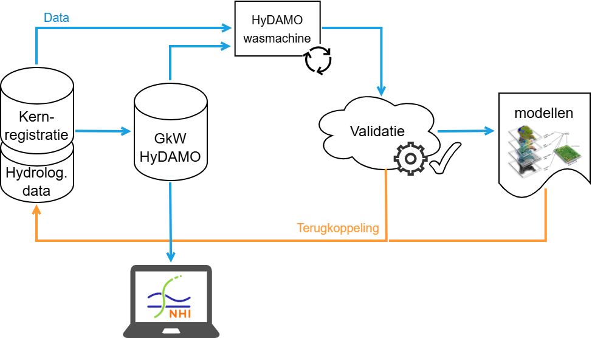

---
hide:
#- navigation
- toc
---

# HyDAMO Validatietool

## Welkom bij het handboek van de HyDAMO Validatietool

Hier is alle informatie verzameld over het gebruik van de Validatietool.

HyDAMO is een standaard met [DAMO](https://damo.hetwaterschapshuis.nl){ target="_blank" } als uitgangspunt voor het eenvoudige modelleren van het oppervlaktewatersysteem. De HyDAMO-validatietool ondersteunt een **circulair modelleerproces** waarin brongegevens continu worden gevalideerd, teruggekoppeld en verbeterd. Hierdoor groeit de kwaliteit en actualiteit van HyDAMO-data met iedere cyclus.

Het uiteindelijke doel is de beschikbaarheid van **betrouwbare en landsdekkende kernregistratiedata van waterschappen**, die eenvoudig kunnen worden ingezet in modelgeneratoren en andere toepassingen. Hoewel de tool primair is ontwikkeld voor waterschappen, is deze ook waardevol voor onder andere provincies, Rijkswaterstaat, kennisinstellingen en adviesbureaus die met hydrologsche data werken.

{ .plaatje_met_margin }

# De Validatietool in een oogopslag

## Wat is de HyDAMO Validatietool?

De HyDAMO Validatietool is in de basis een (online) webservice (validation as a service) waarmee databestanden kunnen worden gevalideerd. Hij bevat drie componenten:

:simple-python:

**Validatiemodule**

 De [Validatiemodule](08%20HyDAMO%20Validatiemodule.md) is de binnenste schil en voert de daadwerkelijke validatie van de datasets door. Hij is ontwikkeld in Python en beschikaar als [openbare repository](https://github.com/HetWaterschapshuis/HyDAMOValidatieModule){:target="_blank"} en standalone [Python package](https://project/hydamo-validation/){:target="_blank"}.

:material-api: 

**Validatie-API**

Met de [Validatie-API](07%20HyDAMO%20validatie-API.md) kun je validatietaken aanmaken, datasets en validatieregels toevoegen, een taak starten en de resultaten downloaden. De API maakt hiervoor gebruik van de rekenmodule.

:material-monitor-screenshot:

**Validatie-Webclient**

 De [Validatie-Webclient](https://validatietool.hydamo.nl/){:target="_blank"}: is de visuele schil van de Validatietool en geeft de gebruiker de mogelijkheid om de API graphisch te besturen. Daarnaast geeft de Webclient ook de mogelijkheid om invoerbestanden en rekenresultaten op de kaart of als tabel te bekijken. Om van de API en Webclient gebruik te kunnen maken is het nodig om een [gebruikersaccount](02%20Gebruikersregistratie.md) te hebben.

## Essentiele onderdelen van een validatie

Verdere kernelementen in het validatieproces zijn:

:fontawesome-solid-book-reader:

**Handboek**

[Handboek](https://github.com/HetWaterschapshuis/HyDAMOValidatiehandboek){:target="_blank"}: Het handboek is een openbare GitHub-repository waarvan deze Wikipedia onderdeel uitmaakt. Dit is de centrale opslagplaats voor relevante documentatie, referentiebestanden en voorbeelddatasets. Onder andere bevinden zich hier de officiele Validatieregelsets, de HyDAMO-datamodelschema's en de HyDAMO-wasmachine.

:material-format-list-checks: 

**Validatieregels**

Bij een validatie horen altijd [validatieregels](05%20Basis%20validatieregels.md) die aangeven op welke aspecten gecontroleerd moet worden. De regels worden in een apart JSON-bestand meegegeven en zijn beschikbaar op de openbare [GitHub-repository](https://github.com/HetWaterschapshuis/HyDAMOValidatiehandboek/tree/main/versies_hydamomodel){:target="_blank"} van het handboek.

:material-washing-machine:

**HyDAMO-wasmachine**

[HyDAMO-wasmachine](https://github.com/HetWaterschapshuis/HyDAMOValidatiehandboek/tree/main/hydamo_wasmachine){:target="_blank"}: De Validatie tooling van HKV wil gegevens conform een vooraf afgesproken formaat. Het is afgesproken dat de invoerdatasets als GeoPackage worden aangeboden, objecten het veld NEN3610ID moeten bevatten en getal-domeinen als omschrijving worden omgezet. De HyDAMO-wasmachine is een FME-gebaseerde GUI die DAMO objecten omzet naar het benodigde formaat. 

:fontawesome-solid-chart-diagram:

**HyDAMO-datamodel**

In de validatieregels moet ook het [HyDAMO-datamodel](https://github.com/HetWaterschapshuis/HyDAMOValidatiehandboek/tree/main/hydamo_wasmachine){:target="_blank"} van de gebruike dataset opgegeven worden onder de parameter 'hydamo_version'. In het HyDAMO-datamodel is vastgelegd welke object(-namen) toegestaan zijn en voor ieder object wat de attribuutdefinities zijn zoals: veldnaam, datatype, toegestane waarden, min- en max-lengte etc.. De HyDAMO-versies 
volgen de jaarlijkse doorontwikkelingen van de HyDAMO-mappings binnen DAMO. 

* [HyDAMO-wasmachine](https://github.com/HetWaterschapshuis/HyDAMOValidatiehandboek/tree/main/hydamo_wasmachine){:target="_blank"}: De Validatie tooling van HKV wil gegevens conform een vooraf afgesproken formaat. Het is afgesproken dat de invoerdatasets als GeoPackage worden aangeboden, objecten het veld NEN3610ID moeten bevatten en getal-domeinen als omschrijving worden omgezet. De HyDAMO-wasmachine is een FME-gebaseerde GUI die DAMO objecten omzet naar het benodigde formaat. 
* HyDAMO-datamodel: In de validatieregels moet ook het HyDAMO-datamodel van de gebruike dataset opgegeven worden onder de parameter 'hydamo_version'. In het HyDAMO-datamodel is vastgelegd welke object(-namen) toegestaan zijn en voor ieder object wat de attribuutdefinities zijn zoals: veldnaam, datatype, toegestane waarden, min- en max-lengte etc.. De HyDAMO-versies 
volgen de jaarlijkse doorontwikkelingen van de HyDAMO-mappings binnen DAMO. 

# Inhoud van deze wiki
- [Gebruikersregistratie](02%20Gebruikersregistratie.md)
- [Known issues en tips](03%20Known%20issues%20en%20tips.md)
- [Versie overzicht](04%20Versie%20overzicht.md)
- [Basis validatieregels](05%20Basis%20validatieregels.md)
- [HyDAMO validatie Webclient](06%20HyDAMO%20validatie%20Webclient.md)
- [HyDAMO validatie-API](07%20HyDAMO%20validatie-API.md)
- [HyDAMO Validatiemodule](08%20HyDAMO%20Validatiemodule.md)
- [Mee-ontwikkelen](09%20Mee-ontwikkelen.md)
- [Gebruikersmiddag HyDAMO Validatietool](10%20Gebruikersmiddag%20HyDAMO%20Validatietool.md)
